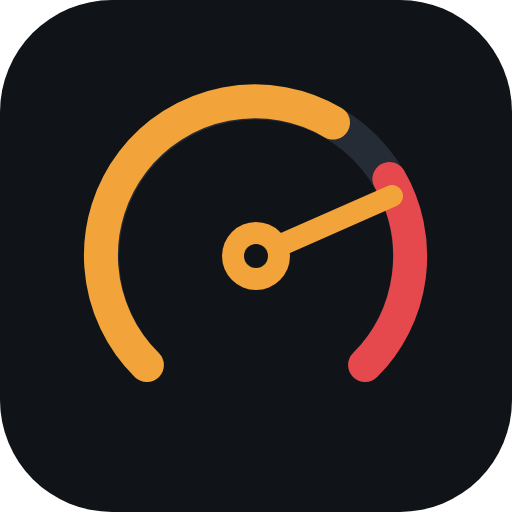

<p align="center"></p>

<h1 align="center">Rupteur</h1>

<p align="center">Le son d'un moteur thermique dans ta voiture électrique, piloté par la vitesse GPS.<br>
Une seule page web, sans installation, sans compte, sans serveur.</p>

---

## Ce que ça fait

Rupteur s'ouvre dans le navigateur de la voiture (ou sur un téléphone connecté en Bluetooth) et joue un moteur qui suit ta conduite : il monte en régime quand tu accélères, passe les rapports, retient en frein moteur, pétarade au lever de pied et souffle sa dump valve.

- **16 moteurs** groupés par origine : V8 muscle et compresseur, V8/V10/V12 italiens, 6 en ligne, V8 biturbo, V10 haut régime et 5 cylindres allemands, 6 en ligne biturbo, VTEC, rotatif et Flat-4 japonais, Flat-6.
- **Moteur à samples** : fondu entre des boucles enregistrées à régime fixe, en charge et pied levé, recalées en hauteur selon le régime.
- **Physique de conduite** : boîte auto ou manuelle, frein moteur, rupteur, patinage d'embrayage au démarrage, sursaut sur coup de pédale franc.
- **Turbo et dump valve** : pression avec inertie, sifflement, pschitt ou flutter au lever de pied, aux passages de rapport et aux levers partiels. Chaque moteur arrive avec sa configuration d'origine, modifiable.
- **Pétarades** irrégulières en frein moteur, au rupteur et aux passages à fond.
- **Mode Test** pour tout écouter à l'arrêt (boutons Gaz/Frein, touches `W`/`S`, `Q`/`E` en manuelle).
- **Import de vrais enregistrements** pour les boucles moteur et les effets.

## Utilisation dans une Tesla

1. Garé, ouvre l'URL de la page dans le navigateur de la voiture et ajoute-la aux favoris.
2. Appuie sur **Démarrer le moteur**, puis sur **Passer en GPS**, et accepte la localisation.
3. Monte le volume média et roule.

Le son passe par les haut-parleurs intérieurs. Une page web ne peut pas utiliser le haut-parleur extérieur du Boombox.

**Variante téléphone** : ouvre la page dans Safari ou Chrome sur le téléphone, connecté à la voiture en Bluetooth. Garde la page au premier plan, le son s'arrête si le navigateur passe en arrière-plan.

> La géolocalisation n'est accordée qu'aux pages servies en **HTTPS**. Un fichier ouvert en local ou servi en `http://` sur le réseau fonctionnera en mode Test, pas en mode GPS.

## Mise en ligne avec GitHub Pages

Le dépôt contient un workflow qui publie la page à chaque push sur `main`.

1. Crée un dépôt sur GitHub et pousse ce dossier :
   ```sh
   git remote add origin git@github.com:<toi>/rupteur.git
   git push -u origin main
   ```
2. Dans **Settings → Pages**, choisis **Source : GitHub Actions**.
3. Une minute plus tard, la page est en ligne sur `https://<toi>.github.io/rupteur/`.

N'importe quel hébergement statique en HTTPS convient aussi (nginx, Cloudflare Pages, Netlify) : il suffit de servir `index.html`.

## Remplacer les sons générés par de vrais enregistrements

Les boucles fournies sont synthétisées pour valider la mécanique. Le réalisme vient des enregistrements. Dans la page, ouvre **Banque de samples → Importer des boucles** et sélectionne des fichiers nommés ainsi :

| Fichier | Rôle |
|---|---|
| `on_3000.wav` | boucle pied au plancher (en charge) à 3 000 tr/min |
| `off_3000.wav` | boucle pied levé (frein moteur) à 3 000 tr/min |
| `pschitt.wav` | dump valve à l'air libre |
| `flutter.wav` | flutter (stu-tu-tu) |
| `pop1.wav`, `pop2.wav`… | une détonation par fichier, tirée au hasard |

Les boucles moteur s'appliquent au moteur sélectionné, les effets à tous les moteurs. Les régimes sont lus dans le nom du fichier : tu peux en fournir autant que tu veux. Le guide d'enregistrement est dans [`samples/README.md`](samples/README.md).

Les imports restent dans la page ouverte et sont perdus au rechargement.

## Ajouter un moteur

Tout est dans le tableau `PROFILES` d'`index.html`. Un moteur se décrit ainsi :

```js
{id:"jz", group:"Japonais", name:"6 en ligne biturbo", sub:"3,0 L, lisse en bas, rauque en haut",
 cyl:6,                      // explosions par cycle moteur (2 tours)
 amp:[1,.95,.98,.94,1,.96],  // intensité de chaque explosion : irrégulier = glouglou
 res:160, decay:52,          // résonance d'échappement (Hz) et amortissement
 noise:.55, drive:2.7, lp:2200, // souffle, saturation, brillance de base
 power:6.4, crk:1.4,         // poussée en mode Test, tendance aux pétarades
 idle:800, redline:7000, limiter:7200,
 final:3.27, gears:[3.83,2.36,1.69,1.31,1.0,0.79],
 turbo:true, spool:3000, dv:"flutter"} // turbo, régime de mise en pression, dump valve d'origine
```

Options : `sc:true` pour un compresseur volumétrique, `cam:{rpm,res,noise}` pour un changement d'arbre à cames type VTEC, `layout:"2 rotors"` pour un libellé particulier. `amp` doit compter exactement `cyl` valeurs.

## Architecture

```
index.html          la page complète : interface, simulation, moteur audio
assets/             logo (SVG, PNG 512 et 180 ; l'icône est aussi intégrée à la page)
samples/            guide d'enregistrement des boucles et des effets
CLAUDE.md           notes techniques pour reprendre le projet
state.json          état d'avancement et prochaines étapes
.github/workflows/  publication GitHub Pages
```

La boucle principale tourne à chaque image :

1. **Vitesse** : mode Test (accélération intégrée) ou GPS (`watchPosition`, vitesse lissée, accélération dérivée qui devient la charge).
2. **Simulation** (`step`) : rapport, régime, frein moteur, rupteur, pression du turbo, déclenchement des effets.
3. **Mixage** (`mixVoices`) : poids des boucles voisines (fondu à puissance constante), mélange en charge / pied levé, filtre, saturation et rugissement d'admission selon la charge.
4. **Effets** sur un bus séparé, hors compresseur du moteur, pour garder leur impact.

Aucune dépendance, aucun build : un éditeur de texte suffit.

## Limites connues

- Le GPS se met à jour environ une fois par seconde : l'accélération est lissée, donc légèrement en retard sur la réalité.
- Sur iPhone, le bouton silencieux peut couper le son ; la page tente de forcer la lecture.
- Les boucles et effets synthétisés restent des approximations.

## Prudence

Garde un volume raisonnable : un bruit de moteur peut masquer les sirènes et les alertes. Règle tout à l'arrêt.

Projet indépendant, sans lien avec Tesla ni avec aucun constructeur. Les noms de moteurs décrivent des architectures, pas des marques.

## Licence

[MIT](LICENSE)
